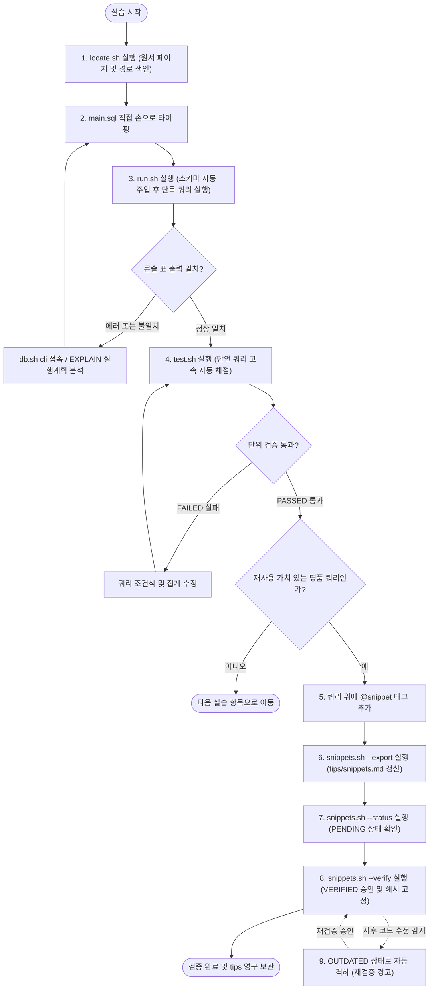

# 🚀 databases 완벽 실습 가이드 (Operational Practice Guide)

> "교안을 펴고 (`locate.sh`) ➔ 직접 손으로 빚어 타이핑하고(Handcrafted) ➔ 쉘 스크립트로 0.1초 만에 검증하고 (`run.sh` / `test.sh`) ➔ 문제 발생 시 DB CLI와 실행 계획(`EXPLAIN`)으로 추적하며 ➔ 명품 쿼리는 사람이 검증하여 `tips/`에 영구 보관한다."

본 문서는 `databases` 저장소를 처음 접하거나 오랜만에 열어보았을 때, "어떻게 사용하지? 어떻게 실습해야 해? 어떤 쉘을 실행하고 어떻게 디버깅하지?" 라는 물음에 대해 가장 직관적인 실습 흐름과 도구 체계를 안내합니다.

---

## 🧭 1. 전체 실습 및 검증 루프 사이클 (Closed-Loop Cycle)

18권 도서의 모든 데이터베이스 실습 항목은 아래의 [탐색 ➔ 타이핑 ➔ 실행 ➔ 테스트 ➔ 디버깅 ➔ 스니펫 등록 ➔ 사람 검증] 폐쇄 루프 사이클로 정복합니다.



### 📋 루프 사이클 핵심 실행 명령 요약표

| 단계 | 실행 명령어 / 행동 | 판단 및 분기 (Branching) | 다음 액션 |
|:---:|:---|:---|:---|
| 1. 위치 색인 | `./scripts/locate.sh <키워드/경로>` | 교재의 몇 장 몇 절 몇 페이지인지 색인 | 해당 PDF(`contents/`) 열람 및 `main.sql` 오픈 |
| 2. 타이핑 | `main.sql` 직접 손코딩 | 주석 가이드(`-- Step 1: ...`) 보며 구현 | 3단계로 이동 |
| 3. 단독 실행 | `./scripts/run.sh <경로>` | • 결과 불일치/에러 ➔ `./scripts/db.sh cli` 접속 및 디버그<br/>• 콘솔 표 출력 정상 ➔ 4단계로 이동 | 스키마 자동 적재 & ASCII 표 확인 |
| 4. 단위 검증 | `./scripts/test.sh <경로>` | • 검증 실패 ➔ 쿼리 조건식 및 조인절 수정<br/>• `test_passed: 1` 통과 ➔ 5단계로 이동 | 0.1초 Fast-path 자동 채점 |
| 5. 스니펫 태그 | 코드에 `-- @snippet("설명")` 부여 | 재사용 가치가 있는 명품 쿼리인지 자가 판단 | 6단계로 이동 (아닐 경우 다음 문제로) |
| 6. 문서 내보내기 | `./scripts/snippets.sh --export` | 마크다운 문서 및 레지스트리 자동 갱신 | `tips/snippets.md` 자동 생성 |
| 7. 상태 확인 | `./scripts/snippets.sh --status` | 🟡 `PENDING_REVIEW` (미검증) 목록 확인 | 대시보드 점검 |
| 8. 사람 검증 승인 | `./scripts/snippets.sh --verify "<제목>"` | 사람이 실행계획 검토 완료 후 승인 서명 | 🟢 `VERIFIED` 격상, 타임스탬프·해시 고정 |
| 9. 블로그 포스트 | `./scripts/snippets.sh --export-blog` | GitHub Pages / Jekyll 호환 기술 포스트 발행 | `tips/posts/*.md` 개별 발행 |
| 사후 변조 감지 | 원본 쿼리 수정 시 자동 감지 | SHA-256 해시 불일치 감지 ➔ 🔴 `OUTDATED` 격하 | 재검증 승인 시까지 경고 유지 |

---

## 🔰 2. 초심자를 위한 `run.sh` & `test.sh` 완벽 사용법

> 💡 골든 룰 (가장 흔한 실수 방지):  
> 터미널에서 `cd practice/...` 로 하위 폴더로 이동하지 마세요!  
> 항상 프로젝트 최상위 루트(`databases/`)에서 명령어를 실행해야 합니다.  
> *(VSCode 또는 터미널을 열었을 때 항상 최상위 루트에 위치해야 합니다.)*

### 2.1 단일 쿼리 즉시 실행: `./scripts/run.sh`
내가 방금 `main.sql`에 짠 코드가 잘 돌아가는지 눈으로 직접 콘솔 테이블 출력을 확인할 때 사용합니다.  
`schema.sql`에 준비된 DDL과 Mock Data를 대상 DBMS에 먼저 적재한 후 쿼리를 실행합니다.

#### 기본 실행 및 자동완성 꿀팁:
```bash
# 기본 실행 예시
./scripts/run.sh practice/01_real_mysql_1/08_인덱스/08_03_01_b_tree_range_scan
./scripts/run.sh practice/03_friendly_sql_tuning/03_인덱스_스캔_효율화/03_03_01_index_seek_and_scan
```
- Tab 키 자동완성: 긴 폴더명을 다 칠 필요 없이, `./scripts/run.sh practice/01_` 까지만 치고 `Tab` 키를 누르면 경로가 자동완성됩니다.
- 경로 단축: `practice/`를 빼먹고 `./scripts/run.sh 01_real_mysql_1/...` 로 쳐도 스크립트가 알아서 찾아줍니다.
- 파일명 포함 가능: 폴더명 뒤에 `main.sql`을 붙여서 실행해도 동일하게 동작합니다.

#### 출력 화면 읽는 법:
- 🟢 성공 시:
  ```text
  deptno | dname
  ------------------
  10 | ACCOUNTING
  40 | OPERATIONS
  (2 rows selected)
  ```
  `README.md`의 예상 결과와 대조하여 일치하면 다음 단계로 진행합니다.
- 🔴 문법 에러 시: 해당 DBMS의 에러 메시지(예: `ORA-00942: table or view does not exist`, `ERROR 1064 (42000): You have an error in your SQL syntax`)가 출력되므로 쿼리를 수정합니다.

---

### 2.2 자동 채점기: `./scripts/test.sh`
내가 짠 쿼리가 의도한 결과 집합 건수나 실행 계획 조건을 만족했는지 기계가 즉시 자동 채점해 주는 도구입니다.

```bash
./scripts/test.sh practice/01_real_mysql_1/08_인덱스/08_03_01_b_tree_range_scan
```

- 🟢 통과했을 때: `test_passed: 1`이 출력됩니다.
- 전체 일괄 검증: 18권 전 도서의 57개 테스트 케이스를 한 번에 검증하려면 `./scripts/test_all.sh`를 실행합니다.

---

## 🦭 3. OrbStack & Podman 컨테이너 인프라 관리

로컬 OS에 여러 DB를 설치할 필요 없이, macOS 고성능 가상화 도구인 OrbStack 또는 OCI 표준 Podman을 통해 격리 구동합니다.

### 3.1 런타임 제어 명령어

```bash
# [옵션 A: OrbStack - 초경량·고속 네이티브 가상화]
./scripts/db.sh orb start         # OrbStack 가동
./scripts/db.sh orb status        # 실행 상태 확인

# [옵션 B: Podman - OCI 표준 루트리스 컨테이너]
./scripts/db.sh machine init      # Podman VM 초기화 (최초 1회)
./scripts/db.sh machine start     # Podman VM 가동

# 공통 컨테이너 제어
./scripts/db.sh up                # 4대 DB(MySQL, PostgreSQL, Oracle, MongoDB) 시작
./scripts/db.sh down              # 컨테이너 전체 중지
./scripts/db.sh status            # 실행 상태 및 포트 점검
```

### 3.2 대화형 CLI 원클릭 접속 (디버깅)
```bash
./scripts/db.sh cli mysql         # MySQL 대화형 CLI 접속
./scripts/db.sh cli postgres      # PostgreSQL psql 접속
./scripts/db.sh cli mongo         # MongoDB mongosh 접속
./scripts/db.sh cli oracle        # Oracle sqlplus 접속
```

### 3.3 환경 설정 파일 (`.env`)
`.env` 파일에서 각 DB의 포트와 비밀번호를 자유롭게 변경할 수 있습니다 (포트 충돌 방지 오프셋 적용):
* MySQL: `13306` (사용자: `practice` / `practice`)
* PostgreSQL: `15432` (사용자: `postgres` / `root`)
* Oracle: `11521` (사용자: `practice` / `practice`, PDB: `FREEPDB1`)
* MongoDB: `27017` (사용자: `root` / `root`)

---

## 🏷️ 4. 스니펫 등록 및 사람 검증 (Human Verification)

1. 스니펫 태깅: 실무에 유용한 쿼리 상단에 주석 태그를 추가합니다:
   ```sql
   -- @snippet("친절한 SQL 튜닝: Index Skip Scan 유도 힌트")
   SELECT /*+ INDEX_SS(e idx_emp_gender_sal) */ ...
   ```
2. 사전 내보내기:
   ```bash
   ./scripts/snippets.sh --export
   ```
   `tips/snippets.md` 및 `tips/snippets_registry.json`이 자동 갱신됩니다.
3. 검증 대시보드 확인:
   ```bash
   ./scripts/snippets.sh --status
   ```
4. 사람 검증 승인 및 해시 고정:
   ```bash
   ./scripts/snippets.sh --verify "Index Skip Scan" --reviewer "홍길동" --notes "실행계획 검증 완료"
   ```
   승인된 코드는 영구 해시가 고정되며, 추후 코드가 1글자라도 변경되면 자동으로 🔴 `OUTDATED`로 격하되어 신뢰성을 보장합니다.
