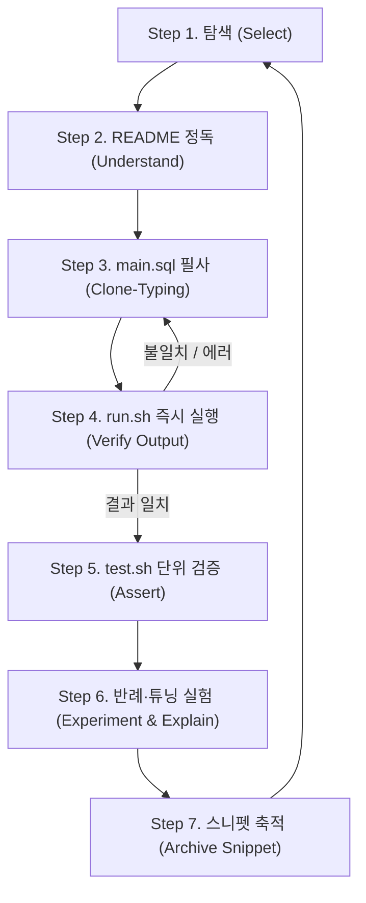

# Databases & SQL 학습 및 실전 튜닝 워크스페이스

다양한 데이터베이스(MySQL, Oracle, PostgreSQL, MongoDB, SQLite, DuckDB)와 SQL 단행본 18권 전 도서를 체계적으로 학습하고, 클론 타이핑(스켈레톤) · 스키마 자동 생성 · 단위 검증 · 실행 계획 분석을 수행하는 통합 실습 저장소입니다.

> 💡 설계 철학: `~/githubs/stoneCpp`의 클론 타이핑 및 검증 프레임워크를 데이터베이스 도메인으로 확장하여, 누락되거나 생략된 테이블 DDL 및 Mock 데이터를 자동으로 생성 보강하고 모든 절을 100% 실행 가능한 코드로 학습합니다.  
> ⚡ 빠른 실행 치트시트: 일상 실습 시 터미널 옆에 띄워두고 바로 볼 수 있는 전용 치트시트는 [`tips/cheatsheet.md`](file:///Users/flynn_macpro/githubs/databases/tips/cheatsheet.md) 를 참고하세요. (CLI: `./scripts/help.sh`)

---

## 📚 18권 도서 전수 학습 트랙 (`practice/`)

프로젝트 내 모든 도서(18권)는 고유 트랙 및 폴더 번호가 부여되어 있으며, 각 절마다 독립된 4~5개 파일로 실습 환경이 구축되어 있습니다.

```
practice/<도서_번호_슬러그>/<대단원>/<항목번호_슬러그>/
  ├── README.md           # 도서 장/절/페이지, 핵심 원리 해설, 따라 칠 완성 목표 쿼리, 예상 실행 결과
  ├── schema.sql (또는 js) # [자동생성] 쿼리가 바로 실행될 수 있는 최소 테이블 DDL 및 Mock Data
  ├── main.sql (또는 js)   # [학습자용] Step별 주석 가이드가 작성된 연습용 스켈레톤 (클론 타이핑)
  ├── test.sql (또는 js)   # [검증기] 결과 집합 단언 및 실행 계획 검증 쿼리
  └── expected_output.txt # 콘솔 예상 출력 서식
```

### 도서별 타겟 DBMS 및 트랙 분류표

| 번호 | 도서 슬러그 (`practice/`) | 도서명 | 원본 PDF (`contents/`) | 타겟 DBMS | 핵심 실습 주제 |
| :--- | :--- | :--- | :--- | :--- | :--- |
| 01 | `01_real_mysql_1` | Real MySQL 8.0 (1권) | `mysql8.0-1.pdf` | MySQL 8.4 | 아키텍처, InnoDB, 잠금, B-Tree 인덱스 내부 구조 |
| 02 | `02_real_mysql_2` | Real MySQL 8.0 (2권) | `mysql8.0-2.pdf` | MySQL 8.4 | EXPLAIN ANALYZE, 쿼리 최적화, 파티셔닝 프루닝 |
| 03 | `03_friendly_sql_tuning` | 친절한 SQL 튜닝 | `친절한-SQL-튜닝.pdf` | Oracle 23ai | 인덱스 스캔 효율화, BETWEEN-IN전환, 조인/소트 튜닝 |
| 04 | `04_oracle_adv_arch_concurrency` | 오라클 성능 고도화: 아키텍처/동시성 | `오라클-성능-고도화-원리와-해법-아키텍처...` | Oracle 23ai | Shared Pool, Redo/Undo, FOR UPDATE NOWAIT 비관적 락 |
| 05 | `05_oracle_adv_index_join` | 오라클 성능 고도화: 인덱스와 조인 | `오라클-성능-고도화-해법-인덱스와-조인.pdf` | Oracle 23ai | 결합인덱스 설계, Hash Join Build/Probe 제어 |
| 06 | `06_oracle_adv_sort_partition` | 오라클 성능 고도화: 소트/파티션 | `오라클-성능-고도화-원리와-해법-소트튜닝...` | Oracle 23ai | Sort Area 최적화, Top-N STOPKEY, 파티션 병렬처리 |
| 07 | `07_oracle_adv_optimizer_rewrite` | 오라클 성능 고도화: 옵티마이저/변환 | `오라클-성능-고도화-원리와-해법-옵티마이저...` | Oracle 23ai | 서브쿼리 Unnesting, View Merging, 조건절 Push-down |
| 08 | `08_oracle_adv_3_tuning_factors` | 오라클 성능 고도화: 3대 튜닝요소 | `오라클-성능-고도화-데이터베이스-3대-튜닝요소...` | Oracle 23ai | 라이브러리 캐시, 바인드 변수, 대기 이벤트(Wait Event) |
| 09 | `09_sql_expert_guide` | SQL 전문가 가이드 (K-Data) | `SQL-전문가-가이드.pdf` | Oracle 23ai | 계층형 질의(START WITH), ROLLUP/CUBE, 윈도우 함수 |
| 10 | `10_practical_sql` | 실용 SQL (Practical SQL) | `실용-SQL.pdf` | PostgreSQL 17 | 통계 집계, 윈도우 프레임(PARTITION BY), JSONB, 정규식 |
| 11 | `11_sql_recipes_data_analysis` | 데이터 분석을 위한 SQL 레시피 | `데이터-분석을-위한-SQL-레시피.pdf` | PostgreSQL 17 | 시계열 누적 매출, 7일 이동평균, 코호트/RFM 분석 |
| 12 | `12_learning_sql` | 러닝 SQL (Learning SQL) | `러닝-SQL.pdf` | MySQL 8.4 | ANSI 표준 문법, 비상관/상관 서브쿼리 필터링, 조인 심화 |
| 13 | `13_sql_cookbook` | SQL Cookbook (2nd Edition) | `sql-cookbook.pdf` | Multi-DB | 5대 DBMS(MySQL, PG, Oracle, MSSQL, SQLite) 방언 상호 비교 |
| 14 | `14_sql_antipatterns` | SQL 안티패턴 | `SQL-안티패턴.pdf` | PostgreSQL 17 | Jaywalking, Naive Trees, 교차 테이블 정규화 리팩토링 |
| 15 | `15_real_mongodb` | Real MongoDB | `real-mongoDB.pdf` | MongoDB 7.0 | 도큐먼트 CRUD, Aggregation 파이프라인($match, $group) |
| 16 | `16_sqld_500` | SQL 개발자(SQLD) 핵심 500제 | `SQL-개발자-기출문제-핵심-500제.pdf` | Oracle 23ai | SQLD 기출 DDL/DML, GROUP BY/HAVING, NVL 연산 |
| 17 | `17_sqlp_1` | SQLP 자격검정 실전문제 1 | `sqlp1.pdf` | Oracle 23ai | NL 조인 드라이빙 최적화, LEADING/USE_NL 힌트, 소량 집합 |
| 18 | `18_sqlp_2` | SQLP 자격검정 실전문제 2 | `sqlp2.pdf` | Oracle 23ai | Direct Path Insert (APPEND 힌트), 버퍼 캐시 우회, 배치 튜닝 |

---

## ⚡ 빠른 시작 (명령어 치트시트)

터미널에서 언제든 `./scripts/help.sh` 를 실행하면 명령어 요약을 볼 수 있습니다.

```bash
# 1. 컨테이너 4대 DB(MySQL, PostgreSQL, MongoDB, Oracle) 백그라운드 시작
./scripts/db.sh up

# 2. 실행 상태 및 포트 점검
./scripts/db.sh status

# 3. 실습 항목 단독 실행 (schema.sql 자동 적재 후 main.sql 실행)
./scripts/run.sh practice/01_real_mysql_1/08_인덱스/08_03_01_b_tree_range_scan
./scripts/run.sh practice/03_friendly_sql_tuning/03_인덱스_스캔_효율화/03_03_01_index_seek_and_scan
./scripts/run.sh practice/10_practical_sql/05_수학과_통계_함수/05_02_01_aggregate_and_window_functions
./scripts/run.sh practice/13_sql_cookbook/03_다중_테이블_작업/03_05_01_outer_join_and_coalesce
./scripts/run.sh practice/15_real_mongodb/03_aggregation/03_01_01_aggregation_group_and_sort

# 4. 검증 쿼리 실행 (test.sql 단언)
./scripts/test.sh practice/13_sql_cookbook/03_다중_테이블_작업/03_05_01_outer_join_and_coalesce

# 5. 등록된 SQL 스니펫 검색 및 마크다운 내보내기
./scripts/snippets.sh                # 등록된 모든 핵심 쿼리 스니펫 출력
./scripts/snippets.sh "인덱스"        # 키워드 필터링 검색
./scripts/snippets.sh --list         # 요약 목록만 보기
./scripts/snippets.sh --export       # tips/sql_snippets.md 자동 생성

# 6. 전 도서 실습 스캐폴딩 일괄 재생성
python3 scripts/generate_all.py
```

---

## 🧩 "비어있는 코드의 생성" 매커니즘

데이터베이스 도서 본문에 쿼리 일부분(`WHERE ...`)이나 생략 부호(`...`)만 있고 테이블 생성문이 누락되어 있는 경우, `scripts/contentXX_data/` 모듈이 다음을 완비하여 스캐폴딩합니다:

1. `schema.sql`: 대상 쿼리가 즉시 실행될 수 있는 최소 단위 DDL(`CREATE TABLE`)과 현실적인 샘플 레코드(`INSERT INTO`)를 자동 생성합니다.
2. `main.sql`: 학습자가 교재를 보며 직접 따라 타이핑할 수 있도록 단계별(`-- Step 1: ...`) 주석 가이드를 제공합니다. (기존 작성한 코드는 `--force` 옵션 없이 덮어쓰지 않습니다.)
3. `target_code`: 생략된 쿼리를 완벽한 실행 가능한 문장으로 복원하여 `README.md`에 제공합니다.
4. `test.sql`: 실행 결과 건수(`COUNT(*) = N`) 또는 실행 계획 상의 인덱스 오퍼레이션(`INDEX RANGE SCAN`)을 검증하는 단언 쿼리를 생성합니다.

---

## 🔄 학습자의 7단계 실습 사이클 (Learner Workflow)

`stoneCpp`의 클론 타이핑 학습법을 바탕으로 다음 7단계를 매일 2~3개 절씩 순환합니다:



1. Step 1. 탐색 (Select): 학습할 도서와 절 디렉터리(`practice/<도서>/<챕터>/<절>`)로 이동합니다.
2. Step 2. 개념 및 스키마 파악 (Understand): 해당 폴더의 `README.md`를 열어 핵심 이론(0장)과 `schema.sql`(1장)의 테이블 구조를 눈으로 익힙니다.
3. Step 3. 클론 타이핑 필사 (Clone-Typing): `main.sql`을 열고 단계별 주석 가이드(`-- Step 1: ...`)를 따라 목표 쿼리를 직접 손으로 타이핑합니다.
4. Step 4. 즉시 실행 및 결과 대조 (Run & Compare): `./scripts/run.sh <경로>`를 실행하여 자동 주입된 스키마 위에서 쿼리가 실행되는 결과를 보고 `README.md`의 예상 결과와 대조합니다.
5. Step 5. 단위 테스트 단언 검증 (Test): `./scripts/test.sh <경로>`를 실행하여 `test_passed: 1`이 반환되는지 확인합니다.
6. Step 6. 반례 및 튜닝 실험 (Experiment): 인덱스를 무효화해보거나 힌트를 변경하여 실행 계획(`EXPLAIN`)과 블록 I/O 수치가 어떻게 바뀌는지 능동적으로 실험합니다.
7. Step 7. 스니펫 아카이빙 및 누적 점검 (Archive): 유용한 쿼리 패턴 상단에 `-- @snippet("설명")`을 달고 `./scripts/snippets.sh --export`로 `tips/sql_snippets.md`에 나만의 사전을 업데이트합니다. 주기적으로 `./scripts/test_all.sh`로 전 도서 무결성을 검증합니다.

---

## 🦭 이종 데이터베이스 런타임 인프라 (`compose.yaml` / Podman)

로컬 OS에 개별 DBMS를 직접 설치할 필요 없이, Podman(또는 Podman Compose)을 통해 루트리스(Rootless) 격리된 4대 DB 컨테이너와 로컬 경량 엔진을 제공합니다. (필요시 Docker 자동 폴백 지원)

### Podman 시작 방법 (macOS)
```bash
# 1. Podman 및 Podman Compose 설치 (Homebrew)
brew install podman podman-compose

# 2. Podman 가상 머신 초기화 및 시작 (최초 1회)
./scripts/db.sh machine init   # CPUs: 2, RAM: 4096MB, Disk: 50GB
./scripts/db.sh machine start  # Podman VM 구동

# 3. 4대 데이터베이스 컨테이너 구동
./scripts/db.sh up             # MySQL, PostgreSQL, MongoDB, Oracle 시작
./scripts/db.sh status         # 실행 상태 점검
```

| 서비스 | 컨테이너명 | 호스트 포트 | 기본 계정 / 비밀번호 | 데이터베이스명 |
| :--- | :--- | :--- | :--- | :--- |
| MySQL | `db_practice_mysql` | `13306` | `practice` / `practice` | `practice_db` |
| PostgreSQL | `db_practice_postgres`| `15432` | `postgres` / `root` | `practice_db` |
| MongoDB | `db_practice_mongo` | `27017` | `root` / `root` | `practice_db` |
| Oracle | `db_practice_oracle` | `11521` | `practice` / `practice` (PDB: `FREEPDB1`) | `FREE` |
| SQLite / DuckDB | 로컬 인메모리 | N/A | 설치 불필요 (파이썬 내장 인메모리 고속 실행) | `:memory:` |

---

## 📌 도서 목차 추출 및 OCR 파이프라인

스캔 이미지 PDF 도서의 경우 macOS 네이티브 Apple Vision 프레임워크를 탑재한 초고속 병렬 OCR 엔진을 사용할 수 있습니다.

```bash
# contents/친절한-SQL-튜닝.pdf 의 1~20페이지(목차 영역)를 텍스트로 추출
./scripts/ocr_pdf contents/친절한-SQL-튜닝.pdf /tmp/ocr_out 1 20
```

---

## 📁 디렉터리 구조

```text
databases/
├── compose.yaml / docker-compose.yml  # 4대 DBMS OCI 표준 컨테이너 구성 파일
├── README.md                          # 본 통합 안내서
├── PROJECT_STRUCTURE.md               # stoneCpp 아키텍처 사상 계승 프로젝트 구조 명세서
├── DATABASE_SYSTEMS.md                # 7대 DBMS 환경 설정 및 방언 비교 매트릭스
├── practice/                          # 18권 도서별 실습 디렉터리 (01_ ~ 18_)
├── scripts/
│   ├── content_registry.py            # 18권 도서 전체 레지스트리 (SSOT)
│   ├── scaffold_engine.py             # 스캐폴딩 및 파일 생성 공통 엔진
│   ├── runner_core.py                 # 다중 DBMS 실행 및 서식화 코어 엔진 (Podman/SQLite)
│   ├── run.sh                         # 단일 실습 항목 실행 러너
│   ├── test.sh                        # 단일 실습 항목 단위 검증 러너
│   ├── test_all.sh                    # 18권 전체 일괄 검증 러너
│   ├── db.sh                          # Podman 컨테이너 & VM 라이프사이클 관리기
│   ├── snippets.sh / .py              # @snippet 추출 및 마크다운 내보내기 도구
│   ├── help.sh                        # 터미널 대화형 명령어 치트시트
│   ├── ocr_pdf (.swift)               # Apple Vision 고속 PDF OCR 도구
│   ├── generate_all.py                # 18권 전 도서 일괄 스캐폴딩 생성기
│   ├── generate_content_01.py ~ 18.py # 개별 도서 스캐폴딩 생성기
│   └── content01_data/ ~ content18_data/ # 도서별 절/단원 실습 데이터셋 정의 모듈
├── tips/
│   ├── cheatsheet.md                  # [치트시트] 일상 학습용 전용 명령어·7단계 사이클·단축키 문서
│   ├── sql_snippets.md                # 자동 추출된 핵심 SQL/NoSQL 스니펫 사전 (57개)
│   └── sql_tuning_pragmatic.md        # 실무 SQL 튜닝 및 인덱스 분석 기법 가이드
├── SQL-docs/                          # 7대 DB 공식 매뉴얼 및 표준 비교 가이드
└── contents/                          # 원본 단행본 PDF 보관 폴더 (.gitignore)
```

## 라이선스

이 저장소에서 직접 작성한 코드와 문서는 [GNU AGPL-3.0-only](./LICENSE)를 따릅니다.
실습이 참고하는 도서·공식 매뉴얼의 원문과, 도서별 요약 데이터(`scripts/content*_data/`)는 저작권자 소유이며 이 저장소에 포함하지 않습니다.
